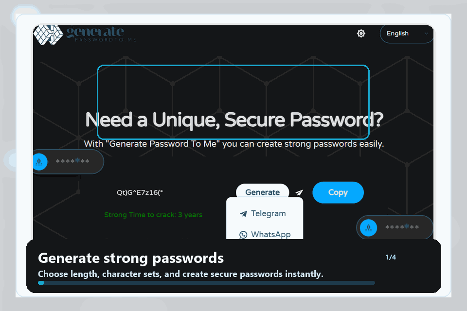
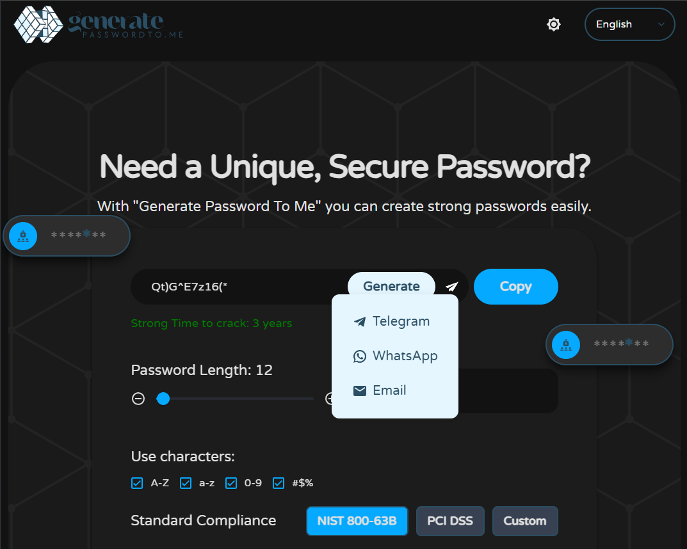
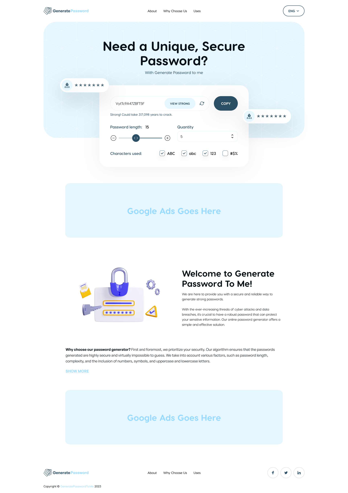

# Generate Password To Me - Secure Password Generator with HIBP Breach Check

A privacy-first password generator, breach checker, and password security tool built with Next.js. It creates strong passwords locally in the browser, estimates password strength with `zxcvbn`, and checks known breach exposure through the Have I Been Pwned Pwned Passwords API without sending the full password.

[](https://www.generatepasswordto.me)
[](https://nextjs.org/)
[](https://www.typescriptlang.org/)
[](https://docs.npmjs.com/cli/commands/npm-audit)
[](LICENSE)

[](https://skillicons.dev)
[](https://skillicons.dev)

## Demo





## Design

[Open the PasswordGenerate design in Figma](https://www.figma.com/design/W6v02rZH7WvjzufLwf0e9i/PasswordGenerate?node-id=0-1&p=f&t=C5W1HR5ar0i38ejx-0)



## Why This Project?

- **Private by design** - generated passwords stay in the browser and are not stored on a server.
- **Developer-readable security** - the HIBP k-anonymity flow is documented with a compact TypeScript example.
- **SEO-ready and multilingual** - the app ships with localized routes, metadata, structured data, guides, and hreflang support.

## Features

- **Secure password generation** - uses browser-side cryptographically strong randomness.
- **Multi-language support** - Ukrainian, English, Spanish, French, German, Italian, Portuguese, Russian, Chinese, Japanese, and Polish.
- **Password strength analysis** - estimates crack time with `zxcvbn`.
- **Password breach check** - checks passwords against Have I Been Pwned Pwned Passwords using k-anonymity.
- **Flexible settings** - password length from 4 to 100 characters.
- **Character selection** - uppercase letters, lowercase letters, numbers, and special symbols.
- **Bulk operations** - generate and copy multiple passwords.
- **Export passwords** - download generated passwords as a text file.
- **Reward animations** - feedback animations for copy and download actions.
- **Responsive design** - works across mobile, tablet, and desktop layouts.
- **Cookie consent** - GDPR-oriented cookie consent management.
- **Analytics and ads** - Google Tag Manager, Vercel Analytics, and AdSense integration.
- **SEO** - localized metadata, structured data, hreflang tags, and guide content.

## Languages

Generate Password To Me currently supports 11 interface languages:

| Flag | Code | Language |
| --- | --- | --- |
| 🇺🇸 | `en` | English |
| 🇺🇦 | `ua` | Українська |
| 🇪🇸 | `es` | Español |
| 🇫🇷 | `fr` | Français |
| 🇩🇪 | `de` | Deutsch |
| 🇮🇹 | `it` | Italiano |
| 🇵🇹 | `pt` | Português |
| 🇷🇺 | `ru` | Русский |
| 🇨🇳 | `zh` | 中文 |
| 🇯🇵 | `ja` | 日本語 |
| 🇵🇱 | `pl` | Polski |

## Translations

Translations are stored in `src/components/lang.json`. The app builds i18next resources from that file automatically, and the language selector reads available language codes from the same translation keys.

To add a new language:

1. Add the new language code to every translation entry in `src/components/lang.json`.
2. Add the language name and flag mapping in `src/utils/languageUtils.js`.
3. Add localized route metadata in `src/app/[locale]/layout.tsx` if the new locale needs custom SEO title, description, or Open Graph text.
4. Add translated guide/static-page content where relevant.
5. Run `npm run build` to verify localized routes and generated metadata.

## Quick Start

### Requirements

- Node.js 22.x
- npm 10 or newer

### Installation

1. Clone the repository:

```bash
git clone https://github.com/devcodex2025/password-generator.git
cd password-generator
```

2. Install dependencies:

```bash
npm install
```

3. Start the development server:

```bash
npm run dev
```

4. Open the app:

```text
http://localhost:3000
```

## Technologies

[](https://skillicons.dev)

- **Framework**: Next.js 16 App Router
- **UI**: React 19, Material UI, Radix UI, NextUI, React Bootstrap
- **Language**: TypeScript and JavaScript
- **Styling**: Tailwind CSS, CSS modules/global styles
- **Password analysis**: zxcvbn
- **Breach checking**: Have I Been Pwned Pwned Passwords API
- **Internationalization**: i18next, react-i18next
- **Data/content**: MongoDB, PostgreSQL, static article modules
- **Analytics**: Google Tag Manager, Vercel Analytics
- **Build/deploy**: Next.js, next-sitemap, Vercel
- **README icons**: [Skill Icons by tandpfun](https://github.com/tandpfun/skill-icons)

### Tooling and Infrastructure

[](https://skillicons.dev)

- **Runtime**: Node.js 22.x
- **Package manager**: npm 10+
- **Version control**: Git and GitHub
- **Hosting target**: Vercel
- **Datastores**: MongoDB and PostgreSQL

## Project Structure

```text
src/
├── app/
│   ├── [locale]/                 # Localized app routes and metadata
│   └── api/                      # Content and sync API routes
├── components/
│   ├── Advertising/              # AdSense banners and fallbacks
│   ├── CookieConsent/            # Cookie banner and consent config
│   ├── PasswordGenerator/        # Main generator UI and controls
│   ├── affiliate/                # Affiliate promo components
│   ├── ui/                       # Shared UI primitives
│   ├── PasswordBreachCheck.tsx   # HIBP password breach checker
│   ├── Header.tsx                # Header and language switcher
│   └── Footer.jsx                # Site footer
├── content/                      # Localized guide article content
├── context/                      # Theme context
├── functions/                    # Password strength helpers
├── lib/                          # Content repositories and infrastructure helpers
├── styles/                       # Global styles
└── utils/                        # Language and link utilities
```

## How to Use

### 1. Generate passwords

- Select password length from 4 to 100 characters.
- Choose how many passwords to generate.
- Enable the character groups you need: uppercase, lowercase, numbers, and symbols.
- Generate, copy, copy all, or download the result.

### 2. Review strength

- Each generated password is analyzed with [`zxcvbn`](https://github.com/dropbox/zxcvbn), a password-strength estimator designed to model realistic guessing attacks instead of relying only on simple character rules.
- We use `zxcvbn` because length, uppercase letters, numbers, and symbols are not enough to describe real password strength. A password like `Password123!` matches common patterns even though it contains multiple character types.
- `zxcvbn` looks for dictionary words, names, dates, keyboard patterns, repeated sequences, l33t substitutions, and other predictable structures.
- The library estimates how many guesses an attacker may need, then converts that into crack-time feedback and a compact score.
- The UI shows a strength level, estimated crack time, and color-coded feedback so users can compare generated passwords quickly.

### 3. Check for known breaches

- Enter a password in the Password Breach Check section.
- The app checks whether that password appears in Have I Been Pwned's Pwned Passwords data.
- The full password is never sent to Have I Been Pwned.

## Password Breach Check

The breach checker is implemented in `src/components/PasswordBreachCheck.tsx` and uses the [Have I Been Pwned Pwned Passwords API](https://haveibeenpwned.com/API/V3).

How it works:

1. The password is hashed locally in the browser with SHA-1 via `crypto.subtle.digest`.
2. The app splits the uppercase SHA-1 hash into a 5-character prefix and the remaining suffix.
3. Only the prefix is sent to `https://api.pwnedpasswords.com/range/{prefix}`.
4. The request includes `Add-Padding: true`, which pads API responses to reduce response-size leakage.
5. HIBP returns matching hash suffixes and occurrence counts for that prefix range.
6. The browser compares the returned suffixes locally against the original suffix.
7. If a suffix matches, the UI shows how many times the password appeared in known breach data.

Official HIBP wording: password checks can be integrated "without sending the full password to our service." See the [Pwned Passwords API getting started guide](https://support.haveibeenpwned.com/hc/en-au/articles/15316377846671-I-wish-to-use-the-Pwned-Passwords-API-How-can-I-get-started).

### Breach Check Code Example

This simplified TypeScript example shows the same k-anonymity flow used by the app:

```ts
async function sha1(text: string): Promise<string> {
  const encoded = new TextEncoder().encode(text);
  const digest = await crypto.subtle.digest('SHA-1', encoded);

  return Array.from(new Uint8Array(digest))
    .map((byte) => byte.toString(16).padStart(2, '0'))
    .join('')
    .toUpperCase();
}

async function checkPasswordBreach(password: string) {
  const hash = await sha1(password);
  const prefix = hash.slice(0, 5);
  const suffix = hash.slice(5);

  const response = await fetch(`https://api.pwnedpasswords.com/range/${prefix}`, {
    headers: {
      'Add-Padding': 'true',
    },
  });

  if (!response.ok) {
    throw new Error(`HIBP request failed with status ${response.status}`);
  }

  const rows = (await response.text()).split('\n');

  for (const row of rows) {
    const [returnedSuffix, count] = row.trim().split(':');

    if (returnedSuffix?.toUpperCase() === suffix) {
      return {
        breached: true,
        count: Number.parseInt(count, 10),
      };
    }
  }

  return {
    breached: false,
    count: 0,
  };
}
```

## Security Notes

- Generated passwords are created locally in the browser.
- Generated passwords are not stored on the server.
- The breach checker sends only the first 5 characters of the password's SHA-1 hash, not the password itself.
- Breach-check results are matched locally in the browser.
- Use a unique password for every account, even when a password is not found in known breach data.

## Security Standards and Guidance

The app is designed around modern password guidance and privacy-first behavior:

- NIST SP 800-63B-oriented password recommendations.
- PCI DSS v4.0-oriented password policy content.
- Have I Been Pwned k-anonymity practices for breach checks.
- Client-side generation and no password storage.
- HTTPS-first deployment expectations.

## Configuration

### Environment variables

Copy `.env.example` and configure only the values needed for your environment.

Common variables include:

```env
NEXT_PUBLIC_GA_ID=G-XXXXXXXXXX
NEXT_PUBLIC_GTM_ID=GTM-XXXXXXX
MONGODB_URI=mongodb+srv://...
MONGODB_DB_NAME=generatepassword
DATABASE_URL=postgres://...
```

### Scripts

```bash
npm run dev
npm run build
npm run start
npm run postbuild
npm run content:validate
npm run db:seed-content
npm run db:seed-content:mongo
```

## Analytics and Ads

- Google Tag Manager for tracking.
- Vercel Analytics for performance monitoring.
- Google AdSense integration with fallback handling.
- Social share and password actions can be tracked via `gtag` events.

GA4 setup: set `NEXT_PUBLIC_GA_ID=G-XXXXXXXXXX` in `.env.local` or in Vercel Project Settings, then redeploy.

## Cookie Management

- GDPR-oriented cookie consent.
- Multi-language cookie banners.
- Configurable cookie categories.
- Automatic language detection.

## Contributing

Human contributors and AI coding agents are welcome. Agent-specific workflow rules live in [`AGENTS.md`](AGENTS.md).

1. Fork the repository.
2. Create a feature branch: `git checkout -b feature/amazing-feature`.
3. Commit your changes: `git commit -m "Add amazing feature"`.
4. Push the branch: `git push origin feature/amazing-feature`.
5. Open a pull request.

## License

This project is licensed under the MIT License. See the `LICENSE` file for details.

## Donations

If this project helps you build safer password workflows, you can support ongoing maintenance through [GitHub Sponsors](https://github.com/sponsors/devcodex2025).

Support helps with dependency maintenance, security reviews, translations, documentation, and keeping the public demo available.

## Support

If you have questions or issues:

- Create an issue on GitHub.
- Send a direct message on [GitHub](https://github.com/lilturtle-dev).
- If you find the project useful, please star the repository.

## Acknowledgements

- [Have I Been Pwned](https://haveibeenpwned.com/) - for the Pwned Passwords API.
- [zxcvbn](https://github.com/dropbox/zxcvbn) - for password strength analysis.
- [Skill Icons](https://github.com/tandpfun/skill-icons) - for README technology icons.
- [Material UI](https://mui.com/) - for UI components.
- [Tailwind CSS](https://tailwindcss.com/) - for styling.
- [React](https://react.dev/) - for the UI framework.
- [Next.js](https://nextjs.org/) - for the application framework.
- [react-rewards](https://github.com/thedevelobear/react-rewards) - for reward animations.
- [vanilla-cookieconsent](https://github.com/orestbida/cookieconsent) - for cookie management.

---

Made with care to keep your accounts secure.
